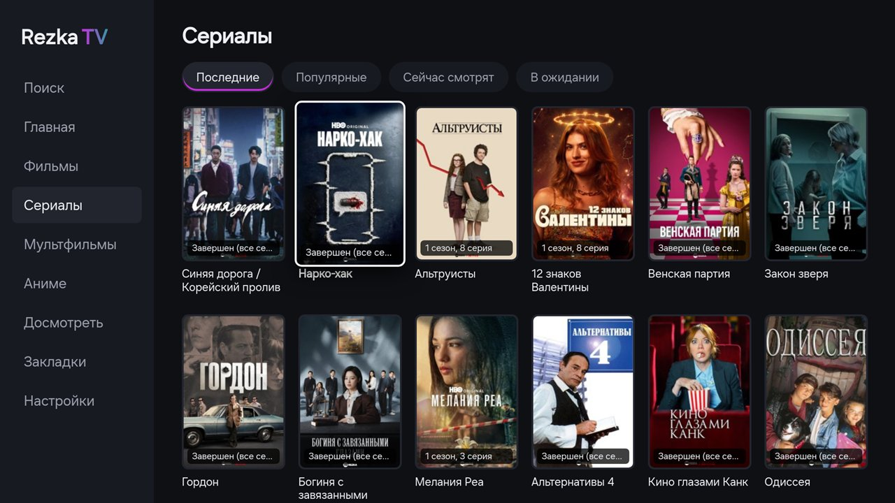
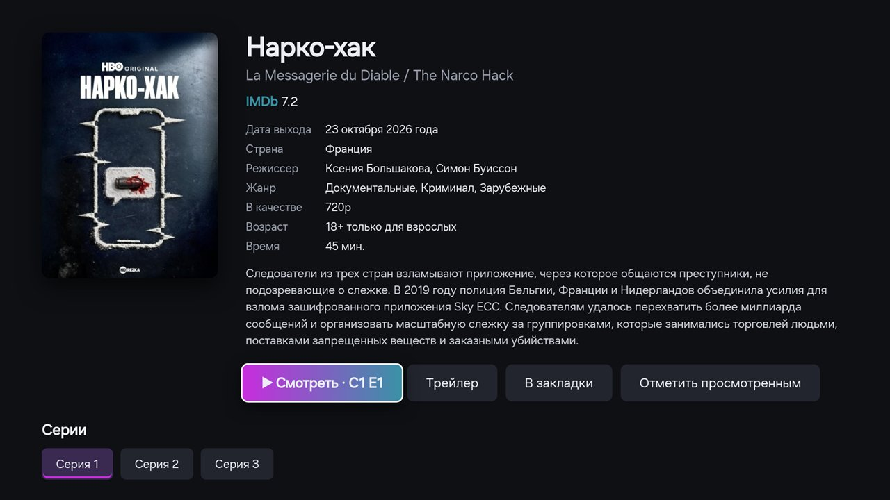
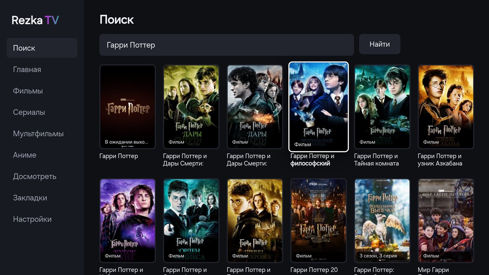
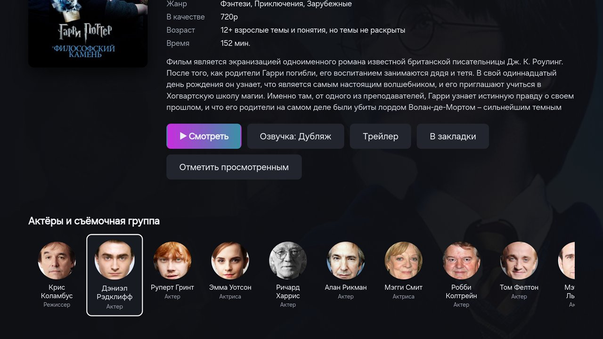
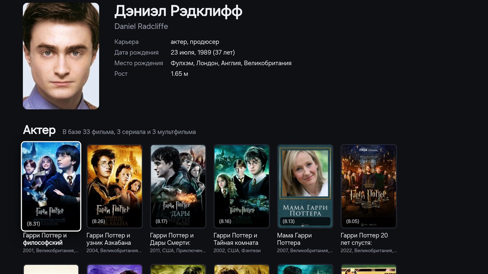

# Rezka TV

Неофициальный клиент HDrezka для телевизоров Samsung на Tizen. Управляется пультом и работает с зеркалами, которые требуют входа в аккаунт. Подходит и для бесплатного аккаунта, и для премиум-подписки.

Проверено на Samsung UE55CU8500 (Tizen 9.0). Должно работать на Tizen 6.0 и новее, то есть на телевизорах примерно с 2021 года.



| Карточка сериала | Поиск |
| --- | --- |
|  |  |
| **Актёры и съёмочная группа** | **Фильмография актёра** |
|  |  |

## Возможности

- Каталог: главная, фильмы, сериалы, мультфильмы и аниме с фильтрами «Последние», «Популярные», «Сейчас смотрят» и «Скоро». Страницы подгружаются автоматически при прокрутке.
- Поиск с экранной клавиатуры телевизора.
- История просмотра на вкладках «Досмотреть» и «Просмотрено». Любой фильм можно отметить просмотренным или удалить из истории.
- Закладки: добавление и удаление прямо из карточки фильма, просмотр по разделам.
- Пометки «Просмотрено», «Досмотреть» и «В закладках» на постерах в каталоге и поиске.
- Карточка фильма: трейлер (YouTube, с переходом в приложение YouTube на ТВ, если встроенный плеер не справится), актёры и режиссёр с переходом к их фильмографии.
- Выбор озвучки, сезона и серии. Просмотренные и начатые серии отмечены.
- Плеер: выбор качества (в том числе премиум-качества при подписке), субтитры, перемотка, переключение серий, автоматический переход к следующей серии. Видео идёт через HLS: обычный MP4 с серверов сайта плеер Tizen запускает очень медленно.
- Позиция просмотра запоминается на телевизоре и отправляется на сайт, поэтому продолжить можно и с другого устройства.
- В настройках можно сменить зеркало и выбрать качество по умолчанию.

## Установка

Приложение не из магазина Samsung, поэтому его нужно собрать и подписать **своим** сертификатом. Подпись Samsung привязана к конкретному телевизору (DUID), так что чужой готовый `.wgt` на ваш ТВ не установится. Инструкция ниже для Windows. На macOS и Linux шаги те же, только вместо `deploy.ps1` нужно выполнить команды из него вручную.

### 1. Tizen Studio

1. Скачайте и установите [Tizen Studio](https://developer.tizen.org/development/tizen-studio/download). Достаточно варианта CLI.
2. В Package Manager (`C:\tizen-studio\package-manager\package-manager.exe`) установите:
   - **Tizen SDK tools** (вкладка Main SDK);
   - **Samsung Certificate Extension** (вкладка Extension SDK → Samsung TV Extensions).

### 2. Режим разработчика на телевизоре

1. Узнайте IP компьютера в локальной сети (`ipconfig`).
2. На ТВ откройте **Приложения** и наберите на пульте `1 2 3 4 5`.
3. Включите **Developer mode** и в поле **Host PC IP** введите IP компьютера.
4. Перезагрузите телевизор полностью: зажмите кнопку питания на пульте, пока не появится логотип Samsung. Простого выключения в режим ожидания недостаточно.
5. Узнайте IP телевизора: **Настройки → Общие → Сеть → Состояние сети → Настройки IP**.

### 3. Сертификат Samsung

1. Подключитесь к ТВ: `C:\tizen-studio\tools\sdb.exe connect <IP телевизора>`.
2. Запустите Certificate Manager (`C:\tizen-studio\tools\certificate-manager\certificate-manager.exe`).
3. Создайте профиль: **+** → **Samsung** → **TV** → назовите его `RezkaTV`.
4. Создайте новый author-сертификат и войдите в аккаунт Samsung, когда менеджер попросит.
5. Создайте distributor-сертификат с уровнем **Public**. Подключённый телевизор подставится в список DUID автоматически.

Сертификат действует несколько лет. Когда срок подойдёт к концу, создайте новый профиль и переустановите приложение.

> Если Certificate Manager не запускается (бывает с новыми сборками Tizen Studio из-за версии Java), запустите его напрямую из папки `tools\certificate-manager`:
> `..\..\jdk\bin\javaw.exe -jar plugins\org.eclipse.equinox.launcher_1.4.0.v20161219-1356.jar`
> (точное имя jar-файла посмотрите в папке `plugins`).

### 4. Сборка и установка

```powershell
powershell -ExecutionPolicy Bypass -File deploy.ps1 -Tv 192.168.1.50
```

Скрипт соберёт пакет, подпишет его профилем `RezkaTV`, установит на ТВ и запустит. Дополнительные параметры:

- `-Profile <имя>` — другое имя профиля сертификата;
- `-TizenStudio <путь>` — Tizen Studio установлена не в `C:\tizen-studio`;
- `-NoInstall` — только собрать `RezkaTV.wgt`;
- переменная окружения `REZKA_TV_IP` — чтобы не указывать `-Tv` каждый раз.

После установки приложение остаётся на телевизоре насовсем и появляется в списке приложений. Режим разработчика нужен только для установки и обновлений.

## Использование

При первом запуске войдите в аккаунт HDrezka (email и пароль). Сессия сохраняется на телевизоре.

Если зеркало по умолчанию (`standby-rezka.tv`) не открывается в вашей стране, адрес можно сменить на экране входа или в **Настройках**.

| Кнопка | Действие |
| --- | --- |
| Стрелки, OK | навигация |
| Back | назад; в плеере сначала скрывает панель |
| Play/Pause | пауза в плеере |
| ←/→ на полосе прогресса | перемотка (нажатия суммируются) |

## Разработка

Это обычное веб-приложение на чистом JavaScript (ES5, без сборки и зависимостей).

```
config.xml        манифест Tizen
index.html
css/app.css       интерфейс под 1920×1080
js/api.js         запросы к сайту и разбор HTML
js/ui.js          навигация пультом, экраны, модальные окна
js/player.js      плеер
js/app.js         экраны приложения
deploy.ps1        сборка, подпись, установка
tools/serve.ps1   локальный сервер для отладки в браузере
```

**Отладка в браузере.** Запустите `powershell -ExecutionPolicy Bypass -File tools\serve.ps1` и откройте http://localhost:8765. На `localhost` приложение ходит на сайт через прокси `/rz/` этого сервера, поэтому CORS и cookies не мешают. Стрелки, Enter и Backspace на клавиатуре работают как пульт.

**Отладка на телевизоре.** Выполните `sdb shell 0 debug RezkaTVapp.RezkaTV`, затем пробросьте выданный порт (`sdb forward tcp:9222 tcp:<порт>`) и подключитесь через `chrome://inspect`.

Если сайт сменит разметку, почти все правки понадобятся в `js/api.js`.

## Отказ от ответственности

Это неофициальный проект, он никак не связан с HDrezka. Приложение не хранит и не распространяет контент: оно только показывает страницы сайта в удобном для телевизора виде. За использование сайта и соблюдение законов вашей страны отвечаете вы.

## Лицензия

[MIT](LICENSE)
